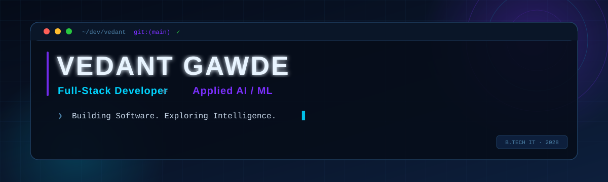
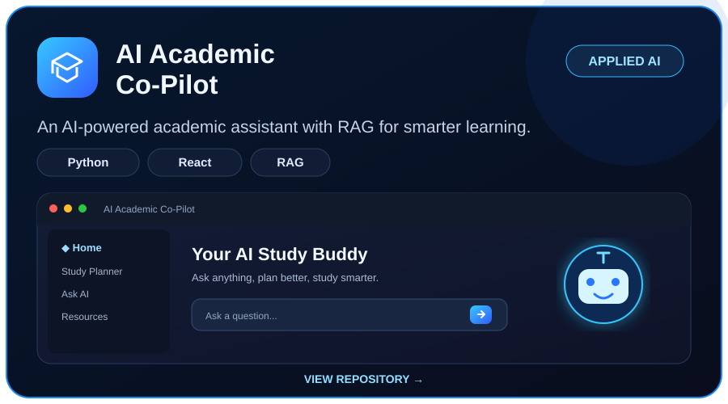
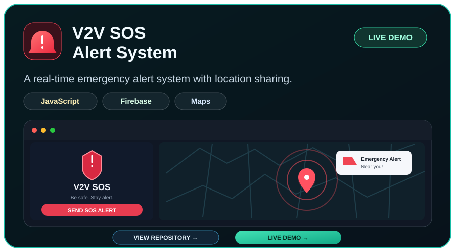
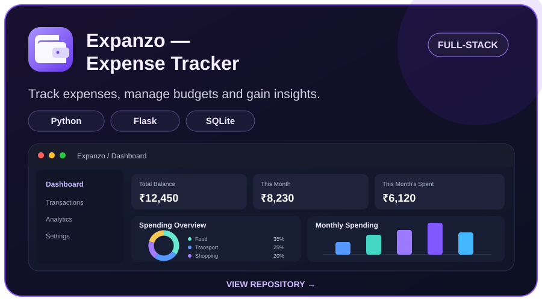

<div align="center">



<br />

[](https://git.io/typing-svg)

<br />

[](https://www.linkedin.com/in/vedant-gawde-1b670a335)
[](mailto:vedantgawde07@gmail.com)
[](https://github.com/VedantDG-07)

</div>

---

## `01` &nbsp; About Me

```yaml
name:       Vedant Gawde
role:       Full-Stack Developer · Applied AI/ML
college:    Shah & Anchor Kutchhi Engineering College (SAKEC), Mumbai
degree:     B.Tech — Information Technology
year:       3rd Year · Graduating 2028
focus:
  - Full-stack application development
  - Applied AI and intelligent system integration
  - Backend engineering, APIs, and database design
principle:  "Understand deeply. Build independently. Improve continuously."
```

## `02` &nbsp; Toolkit

<div align="center">

**Languages** · Java · Python · JavaScript · SQL  
**Frontend** · HTML · CSS · JavaScript  
**AI & Data** · NumPy · pandas · Feature Extraction  
**Tools** · Git · GitHub · VS Code

<br />


</div>

---

## `03` &nbsp; Selected Work

### 🤖 AI Academic Co-Pilot

[](https://github.com/VedantDG-07/AI-Academic-Co-pilot)

An AI-powered academic assistant with RAG for smarter learning.

**Stack:** Python · React · RAG · [View repository](https://github.com/VedantDG-07/AI-Academic-Co-pilot)

### 🚨 V2V SOS Alert System

[](https://github.com/VedantDG-07/V2V-SOS-Alert-System)

A real-time emergency alert system with location sharing.

**Stack:** JavaScript · Firebase · Maps · [View repository](https://github.com/VedantDG-07/V2V-SOS-Alert-System) · [Live demo](https://v2v-sos.web.app/)

### 💸 Expanzo — Expense Tracker

[](https://github.com/VedantDG-07/Expense-Tracker)

Track expenses, manage budgets, and gain insights.

**Stack:** Python · Flask · SQLite · [View repository](https://github.com/VedantDG-07/Expense-Tracker)

---

## `04` &nbsp; Currently Exploring

| Area | Focus |
|:---|:---|
| 🌐 Full-stack | Building complete web applications end-to-end |
| 🤖 Applied AI/ML | Integrating practical AI into real products |
| ⚙️ Backend | APIs, server architecture, and database design |
| 📊 Data | Processing and visualizing data |
| 🧠 DSA | Algorithms and interview prep in Java |

---

## `05` &nbsp; GitHub Activity

<div align="center">

<a href="https://github.com/VedantDG-07"></a>

</div>

---

## `06` &nbsp; Pac-Man Contribution Graph 👾

<div align="center">



</div>

---

## `07` &nbsp; Connect

<div align="center">

I'm open to **job and internship opportunities**, **collaborative projects**, and conversations about **software engineering** and **applied AI**.

<br />

[](https://www.linkedin.com/in/vedant-gawde-1b670a335)
[](mailto:vedantgawde07@gmail.com)
[](https://github.com/VedantDG-07)

<br /><br />

<i>Understand deeply. Build independently. Improve continuously.</i>

<br /><br />


</div>
